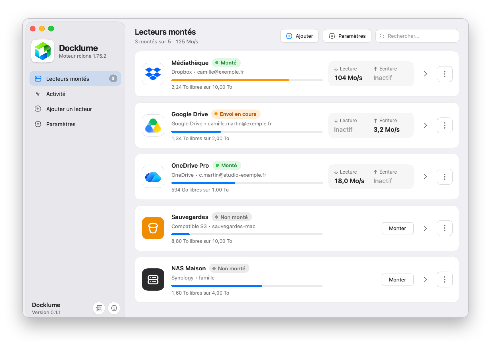
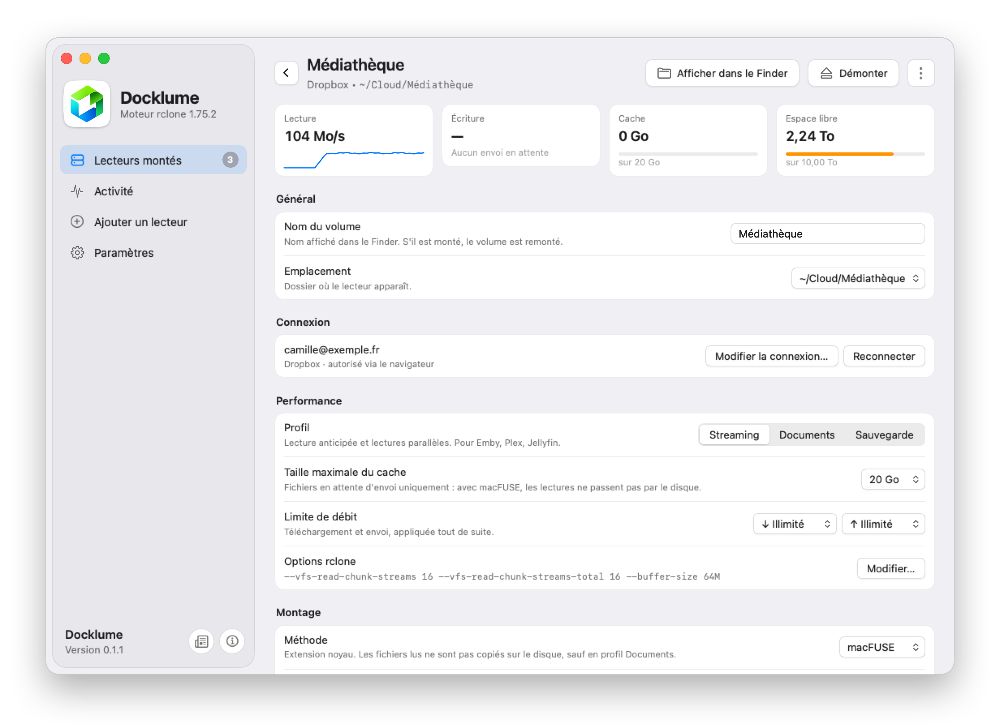
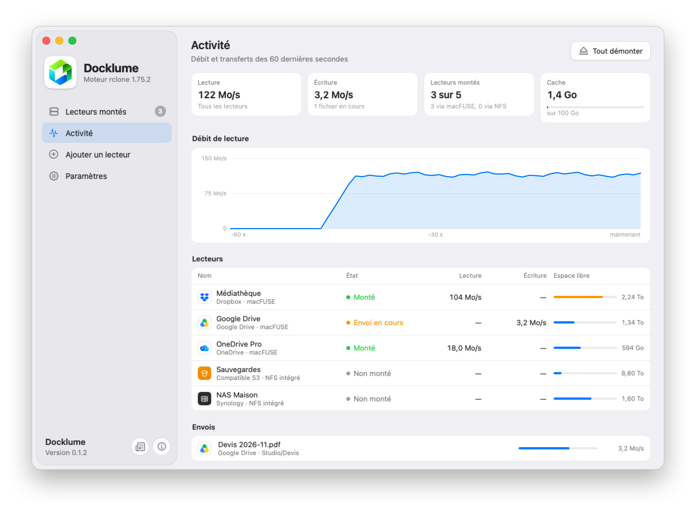
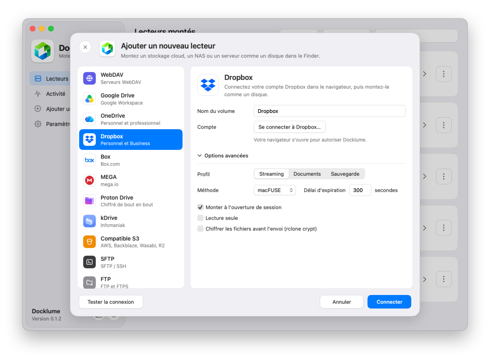
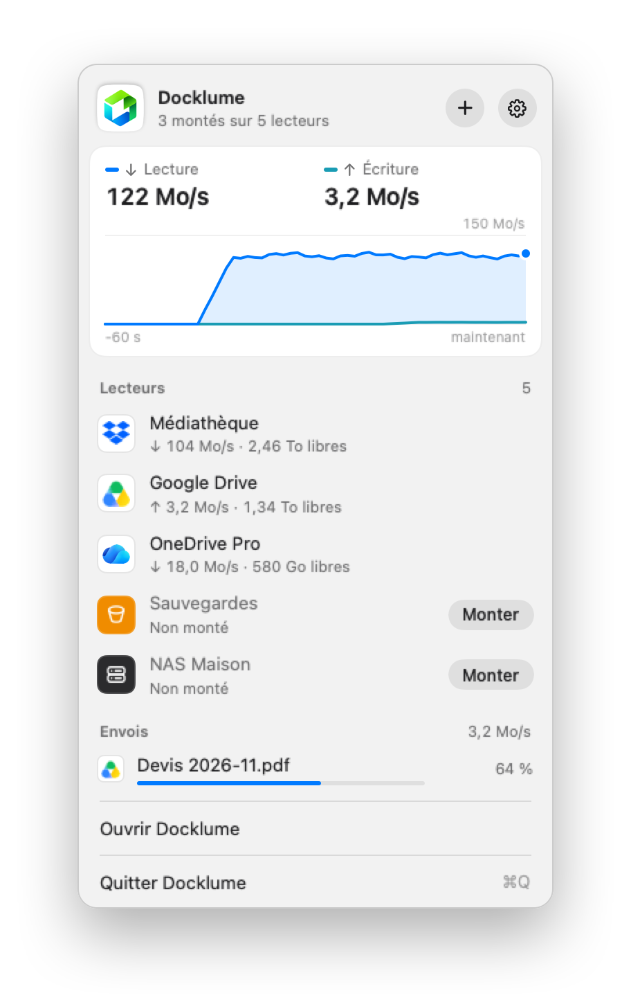
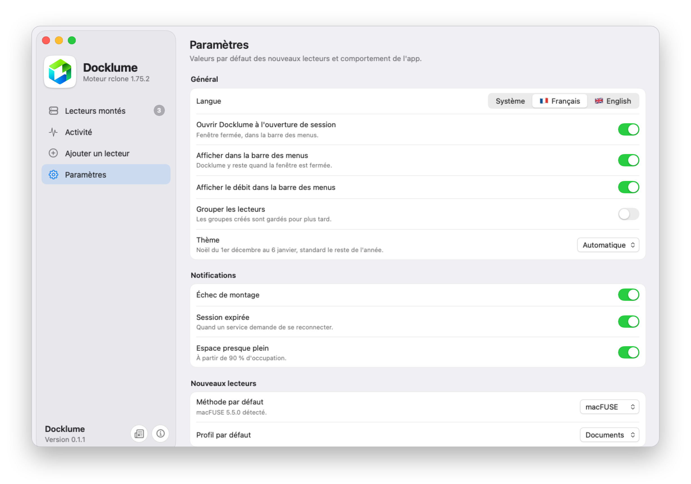
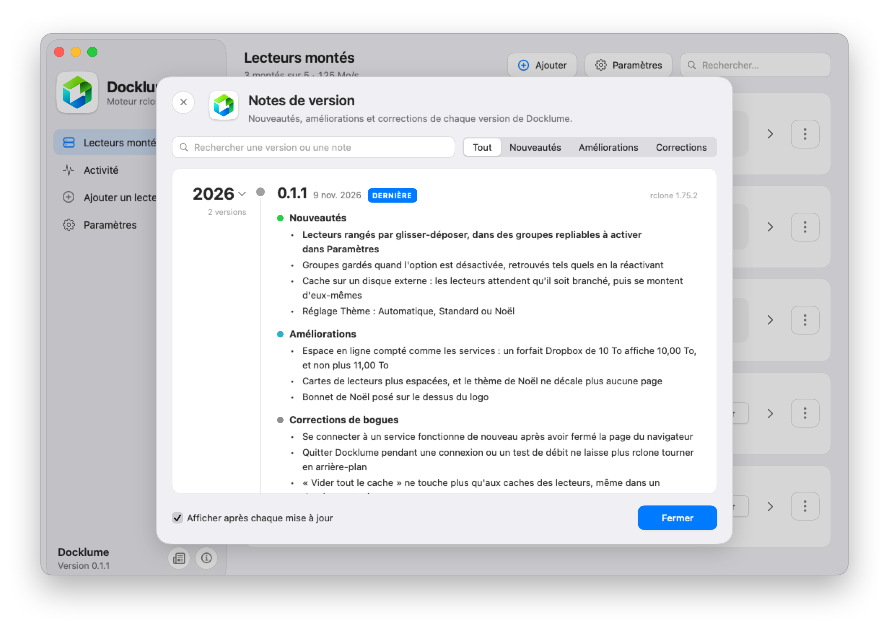

<p align="center">
  
</p>

<h1 align="center">Docklume</h1>

<p align="center"><a href="README.md">English</a> · <b>Français</b></p>

<p align="center">
  <b>Vos stockages en ligne, montés comme des disques dans le Finder.</b>
</p>

<p align="center">
  <a href="https://github.com/LFR-54/Docklume/releases/latest"></a>
  
  <a href="LICENSE"></a>
</p>

<p align="center">
  <picture>
    <source media="(prefers-color-scheme: dark)" srcset="docs/images/fr/drives-dark.png">
    
  </picture>
</p>

Docklume fait apparaître vos comptes Dropbox, Google Drive ou OneDrive, votre NAS et vos serveurs dans le Finder, comme des disques. Vos fichiers restent en ligne : vous les ouvrez, les modifiez et les copiez comme s'ils étaient sur votre Mac. C'est l'équivalent de RaiDrive, pensé pour macOS.

## Fonctionnalités

- **Vos comptes dans le Finder.** Chaque compte devient un lecteur, utilisable par toutes vos apps, Emby, Plex ou Jellyfin compris.
- **Réglé selon l'usage.** Vidéo, documents ou sauvegarde : chaque lecteur est réglé pour ce que vous en faites.
- **Le débit en direct.** Dans la fenêtre et dans la barre des menus, lecteur par lecteur.
- **Toujours prêt.** Docklume démarre avec votre session, reste dans la barre des menus et monte les lecteurs de votre choix.
- **Rien de perdu.** Un fichier pas encore envoyé reste sur le Mac jusqu'à son envoi, et Docklume prévient avant de démonter ou de quitter.
- **Coupures gérées.** Après une coupure d'Internet, vos lecteurs reprennent seuls.
- **Tags du Finder.** Tags et couleurs restent sur vos fichiers en ligne, avec macFUSE.
- **Chiffrement.** Un lecteur peut chiffrer vos fichiers sur le Mac, avant leur envoi.
- **En français ou en anglais.** Docklume suit la langue de macOS, ou celle que vous choisissez dans Paramètres.
- **Privé.** Pas de compte Docklume, pas de serveur intermédiaire, aucune télémétrie.

## Services pris en charge

| Type | Services |
| --- | --- |
| **Stockage en ligne** | Dropbox (personnel et Business), Google Drive (et Google Workspace), OneDrive (personnel et professionnel), Box, MEGA, Proton Drive, kDrive d'Infomaniak |
| **Stockage objet** | Amazon S3 et compatibles : Backblaze B2, Wasabi, Cloudflare R2… |
| **NAS** | Synology, QNAP, et tout NAS accessible en SMB ou en WebDAV |
| **Serveurs** | Nextcloud et ownCloud, WebDAV, SFTP, FTP et FTPS, partages Windows (SMB) |

Vous utilisez déjà rclone ? Les remotes de votre `rclone.conf`, de n'importe quel type, sont repris au premier lancement, en lecture seule tant que vous ne changez pas ce réglage.

## En images

<table>
  <tr>
    <td width="50%" align="center" valign="top">
<picture>
  <source media="(prefers-color-scheme: dark)" srcset="docs/images/fr/detail-dark.png">
  
</picture>
      <p align="center"><b>Fiche du lecteur</b><br><sub>Profil, cache, limite de débit et méthode de montage, lecteur par lecteur</sub></p>
    </td>
    <td width="50%" align="center" valign="top">
<picture>
  <source media="(prefers-color-scheme: dark)" srcset="docs/images/fr/activity-dark.png">
  
</picture>
      <p align="center"><b>Activité</b><br><sub>Le débit des 60 dernières secondes et les envois en cours</sub></p>
    </td>
  </tr>
  <tr>
    <td width="50%" align="center" valign="top">
<picture>
  <source media="(prefers-color-scheme: dark)" srcset="docs/images/fr/add-dark.png">
  
</picture>
      <p align="center"><b>Ajout d'un lecteur</b><br><sub>Choisissez le service, connectez-vous dans le navigateur</sub></p>
    </td>
    <td width="50%" align="center" valign="top">
<picture>
  <source media="(prefers-color-scheme: dark)" srcset="docs/images/fr/panel-dark.png">
  
</picture>
      <p align="center"><b>Barre des menus</b><br><sub>Débit, lecteurs et envois, sans ouvrir la fenêtre</sub></p>
    </td>
  </tr>
  <tr>
    <td width="50%" align="center" valign="top">
<picture>
  <source media="(prefers-color-scheme: dark)" srcset="docs/images/fr/settings-dark.png">
  
</picture>
      <p align="center"><b>Paramètres</b><br><sub>Langue, ouverture de session, notifications, cache et moteur</sub></p>
    </td>
    <td width="50%" align="center" valign="top">
<picture>
  <source media="(prefers-color-scheme: dark)" srcset="docs/images/fr/notes-dark.png">
  
</picture>
      <p align="center"><b>Notes de version</b><br><sub>Les nouveautés de chaque version, dans l'app</sub></p>
    </td>
  </tr>
</table>


## Configuration requise

- Un Mac Apple Silicon (M1 ou plus récent), sous macOS 15 Sequoia ou plus récent.
- macFUSE, facultatif : voir [macFUSE ou NFS](#macfuse-ou-nfs-).
- Rien d'autre : rclone est inclus dans l'app.

## Installer

1. Téléchargez `Docklume-0.1.zip` depuis la [dernière version](https://github.com/LFR-54/Docklume/releases/latest), ouvrez-le et glissez Docklume dans Applications.
2. Au premier lancement, macOS bloque l'app, qui n'est pas encore notariée par Apple. Ouvrez **Réglages Système › Confidentialité et sécurité**, puis cliquez sur **Ouvrir quand même**.

## Premiers pas

1. Cliquez sur **Ajouter** et choisissez votre service.
2. Connectez-vous : dans le navigateur pour Dropbox, Google Drive, OneDrive et Box, avec vos identifiants pour les autres.
3. Cliquez sur **Monter** : le lecteur apparaît dans le Finder, et dans le dossier `Cloud` de votre dossier personnel.

## macFUSE ou NFS ?

Docklume monte vos lecteurs de deux façons, au choix pour chaque lecteur, dans sa fiche :

- **macFUSE**, la plus complète : les tags du Finder sont gardés, et une vidéo se lit sans remplir le disque. Il faut installer [macFUSE](https://macfuse.github.io) et autoriser son extension ; sur un Mac Apple Silicon, macOS demande d'abord de réduire la sécurité depuis le mode de récupération.
- **NFS intégré**, sans rien installer : macOS sait déjà le faire. Les tags du Finder ne sont pas gardés.

## Google Drive : utilisez votre propre clé

Google limite souvent la clé que rclone partage entre tous ses utilisateurs, ce qui ralentit le lecteur. Avec votre propre clé, gratuite, il a son propre quota : créez-la en suivant le [guide de rclone](https://rclone.org/drive/#making-your-own-client-id), puis ajoutez-la dans la fiche du lecteur, **Clé Google › Utiliser ma clé…**

## Désinstaller

Attendez la fin des envois en cours, quittez Docklume depuis la barre des menus, puis mettez l'app à la corbeille. Ses réglages sont dans `~/Library/Application Support/Docklume` et ses caches dans `~/Library/Caches/Docklume`. Vos comptes restent dans `~/.config/rclone/rclone.conf`.

## Compiler

Il faut Xcode 26 ou plus récent, [Go](https://go.dev/dl/) 1.26 et macFUSE 5.

```bash
git clone https://github.com/LFR-54/Docklume.git && cd Docklume
scripts/build-rclone.sh
xcodebuild -project Docklume.xcodeproj -scheme Docklume -configuration Release -derivedDataPath build/DerivedData build
```

`build-rclone.sh` télécharge rclone 1.75.2 et lui applique les correctifs de [`rclone-patches/`](rclone-patches). L'app se trouve ensuite dans `build/DerivedData/Build/Products/Release`.

## Licence

Docklume est sous [licence MIT](LICENSE), comme rclone et ses correctifs. macFUSE n'est pas inclus. [Règles de confidentialité](https://lfr-54.github.io/Docklume/confidentialite.html).

Les logos des services appartiennent à leurs propriétaires et servent seulement à les reconnaître. Ils viennent de [Wikimedia Commons](https://commons.wikimedia.org) : celui de Nextcloud vient d'openDesk (Apache 2.0), les autres sont dans le domaine public. L'icône de kDrive est © Infomaniak, redessinée d'après [ios-kDrive](https://github.com/Infomaniak/ios-kDrive) (GPL-3.0).
