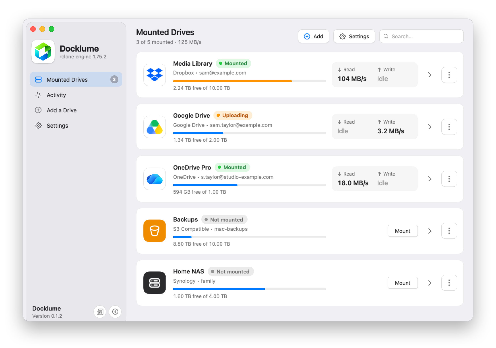
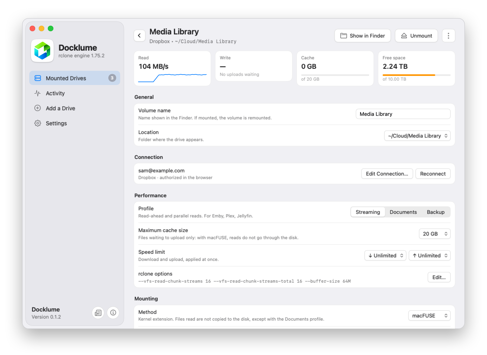
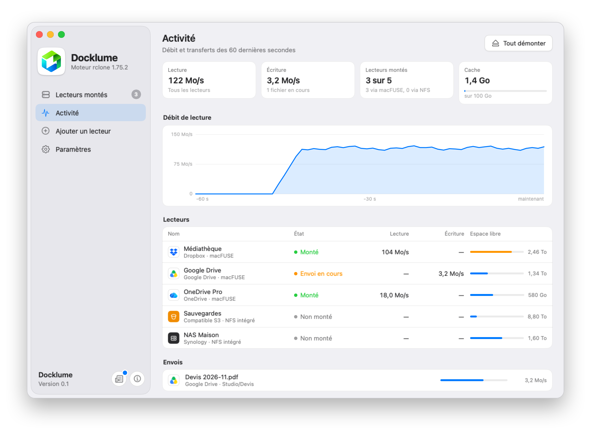
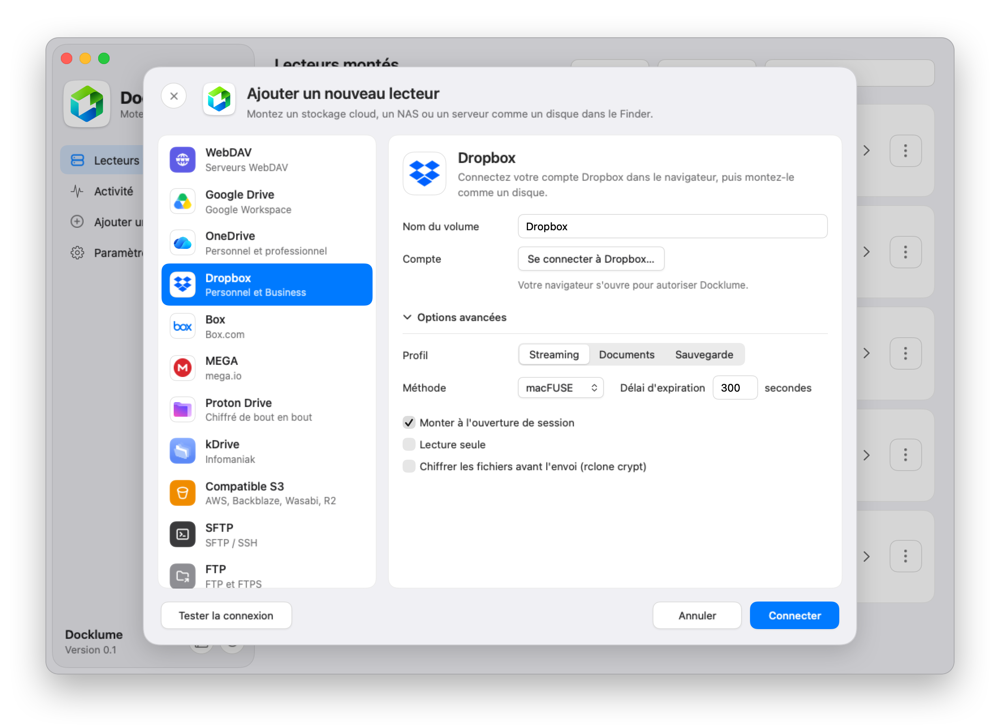
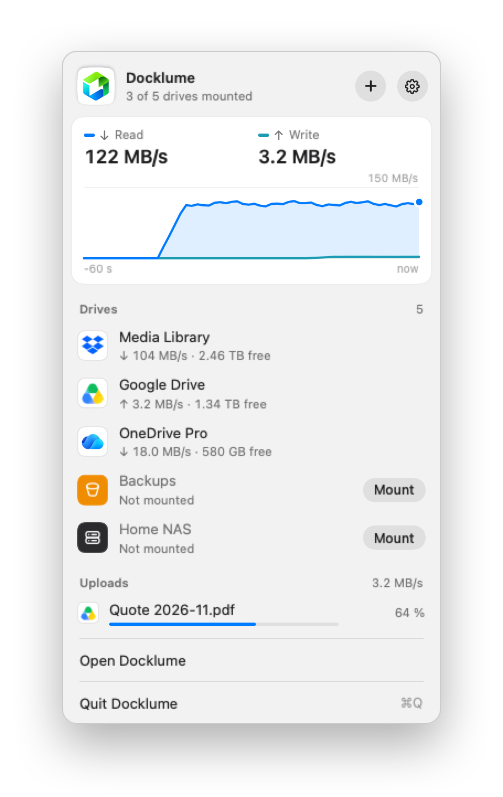
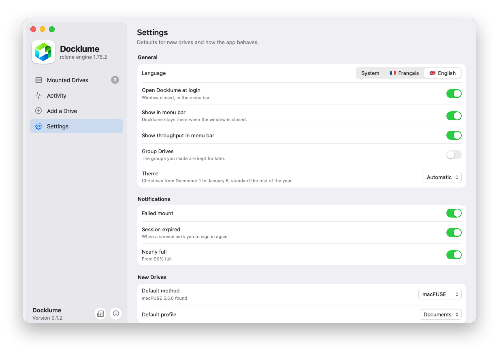
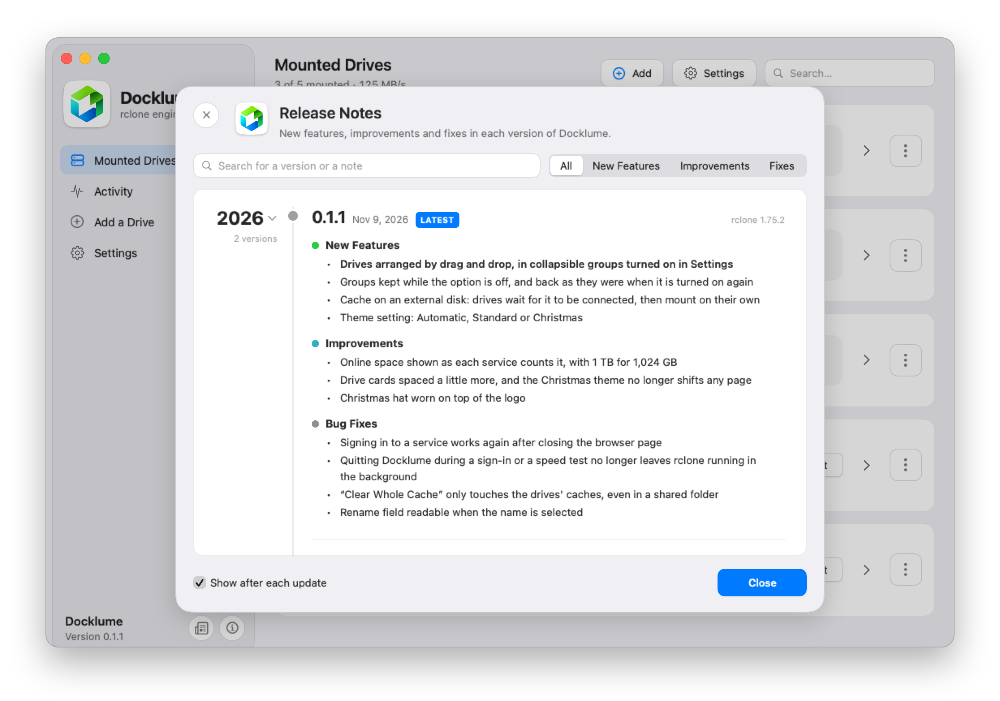

<p align="center">
  
</p>

<h1 align="center">Docklume</h1>

<p align="center"><b>English</b> · <a href="README.fr.md">Français</a></p>

<p align="center">
  <b>Your cloud storage, mounted as disks in the Finder.</b>
</p>

<p align="center">
  <a href="https://github.com/LFR-54/Docklume/releases/latest"></a>
  
  <a href="LICENSE"></a>
</p>

<p align="center">
  <picture>
    <source media="(prefers-color-scheme: dark)" srcset="docs/images/drives-dark.png">
    
  </picture>
</p>

Docklume brings your Dropbox, Google Drive or OneDrive accounts, your NAS and your servers into the Finder, as disks. Your files stay online: you open, edit and copy them as if they were on your Mac. Think RaiDrive, made for macOS.

## Features

- **Your accounts in the Finder.** Each account becomes a drive that every app can use, Emby, Plex and Jellyfin included.
- **Tuned for the job.** Video, documents or backups: each drive is set up for what you do with it.
- **Live throughput.** In the window and in the menu bar, drive by drive.
- **Always ready.** Docklume starts with your session, stays in the menu bar and mounts the drives you choose.
- **Nothing lost.** A file not uploaded yet stays on the Mac until it is, and Docklume warns you before unmounting or quitting.
- **Outages handled.** After an Internet outage, your drives pick up on their own.
- **Finder tags.** Tags and colors stay on your online files, with macFUSE.
- **Encryption.** A drive can encrypt your files on the Mac, before they are uploaded.
- **English or French.** Docklume follows the language of macOS, or the one you pick in Settings.
- **Private.** No Docklume account, no server in between, no telemetry.

## Supported services

| Type | Services |
| --- | --- |
| **Cloud storage** | Dropbox (Personal and Business), Google Drive (and Google Workspace), OneDrive (Personal and work), Box, MEGA, Proton Drive, Infomaniak kDrive |
| **Object storage** | Amazon S3 and compatibles: Backblaze B2, Wasabi, Cloudflare R2… |
| **NAS** | Synology, QNAP, and any NAS reachable over SMB or WebDAV |
| **Servers** | Nextcloud and ownCloud, WebDAV, SFTP, FTP and FTPS, Windows shares (SMB) |

Already using rclone? The remotes in your `rclone.conf`, of any type, are picked up at first launch, read-only until you change that setting.

## Screenshots

<table>
  <tr>
    <td width="50%" align="center" valign="top">
<picture>
  <source media="(prefers-color-scheme: dark)" srcset="docs/images/detail-dark.png">
  
</picture>
      <p align="center"><b>Drive page</b><br><sub>Profile, cache, speed limit and mount method, drive by drive</sub></p>
    </td>
    <td width="50%" align="center" valign="top">
<picture>
  <source media="(prefers-color-scheme: dark)" srcset="docs/images/activity-dark.png">
  
</picture>
      <p align="center"><b>Activity</b><br><sub>Throughput over the last 60 seconds and uploads in progress</sub></p>
    </td>
  </tr>
  <tr>
    <td width="50%" align="center" valign="top">
<picture>
  <source media="(prefers-color-scheme: dark)" srcset="docs/images/add-dark.png">
  
</picture>
      <p align="center"><b>Adding a drive</b><br><sub>Pick the service, sign in in the browser</sub></p>
    </td>
    <td width="50%" align="center" valign="top">
<picture>
  <source media="(prefers-color-scheme: dark)" srcset="docs/images/panel-dark.png">
  
</picture>
      <p align="center"><b>Menu bar</b><br><sub>Throughput, drives and uploads, without opening the window</sub></p>
    </td>
  </tr>
  <tr>
    <td width="50%" align="center" valign="top">
<picture>
  <source media="(prefers-color-scheme: dark)" srcset="docs/images/settings-dark.png">
  
</picture>
      <p align="center"><b>Settings</b><br><sub>Language, login, notifications, cache and engine</sub></p>
    </td>
    <td width="50%" align="center" valign="top">
<picture>
  <source media="(prefers-color-scheme: dark)" srcset="docs/images/notes-dark.png">
  
</picture>
      <p align="center"><b>Release notes</b><br><sub>What's new in each version, inside the app</sub></p>
    </td>
  </tr>
</table>

## Requirements

- A Mac with Apple Silicon (M1 or later), running macOS 15 Sequoia or later.
- macFUSE, optional: see [macFUSE or NFS?](#macfuse-or-nfs)
- Nothing else: rclone comes with the app.

## Install

1. Download `Docklume-0.1.zip` from the [latest release](https://github.com/LFR-54/Docklume/releases/latest), open it and drag Docklume to Applications.
2. On first launch, macOS blocks the app, which is not notarized by Apple yet. Open **System Settings › Privacy & Security**, then click **Open Anyway**.

## Getting started

1. Click **Add** and pick your service.
2. Sign in: in the browser for Dropbox, Google Drive, OneDrive and Box, with your credentials for the others.
3. Click **Mount**: the drive appears in the Finder, and in the `Cloud` folder of your home folder.

## macFUSE or NFS?

Docklume mounts your drives in one of two ways, chosen for each drive on its page:

- **macFUSE**, the most complete: Finder tags are kept, and a video plays without filling the disk. You need to install [macFUSE](https://macfuse.github.io) and allow its extension; on a Mac with Apple Silicon, macOS first asks you to reduce security from Recovery mode.
- **Built-in NFS**, nothing to install: macOS already knows how. Finder tags are not kept.

## Google Drive: use your own key

Google often limits the key rclone shares between all its users, which slows the drive down. With your own key, which is free, the drive gets its own quota: create it by following [rclone's guide](https://rclone.org/drive/#making-your-own-client-id), then add it on the drive's page, **Google key › Use My Key…**

## Uninstall

Wait for uploads in progress to finish, quit Docklume from the menu bar, then move the app to the Trash. Its settings are in `~/Library/Application Support/Docklume` and its caches in `~/Library/Caches/Docklume`. Your accounts stay in `~/.config/rclone/rclone.conf`.

## Build

You need Xcode 26 or later, [Go](https://go.dev/dl/) 1.26 and macFUSE 5.

```bash
git clone https://github.com/LFR-54/Docklume.git && cd Docklume
scripts/build-rclone.sh
xcodebuild -project Docklume.xcodeproj -scheme Docklume -configuration Release -derivedDataPath build/DerivedData build
```

`build-rclone.sh` downloads rclone 1.75.2 and applies the patches in [`rclone-patches/`](rclone-patches). The app is then in `build/DerivedData/Build/Products/Release`.

## License

Docklume is under the [MIT License](LICENSE), like rclone and its patches. macFUSE is not included. [Privacy policy](https://lfr-54.github.io/Docklume/privacy.html).

Service logos belong to their owners and are used only to identify them. They come from [Wikimedia Commons](https://commons.wikimedia.org): Nextcloud's from openDesk (Apache 2.0), the others are in the public domain. The kDrive icon is © Infomaniak, redrawn from [ios-kDrive](https://github.com/Infomaniak/ios-kDrive) (GPL-3.0).
